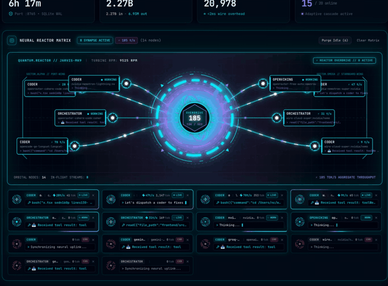

# WireLLM ⚡🦀
### The ultra-light Autonomous LLM Gateway — everything is an **MCP tool**

[](https://opensource.org/licenses/Apache-2.0)
[](https://www.rust-lang.org/)
[]()
[]()
[]()

**WireLLM** is a tiny, lightning-fast, self-healing LLM gateway and **native Model Context Protocol (MCP) server** written in 100% pure Rust. It sits invisibly between your AI coding agents (OpenCode, Claude Code, Cursor, Windsurf, Antigravity, any SDK) and a pool of free + paid LLM providers — and it lets your agents **configure and run the whole thing themselves, over MCP.**

> **The pitch in one line:** point your agents at WireLLM, let them wire up every free provider under the sun, and quietly harvest a *massive* pool of free tokens every month — while the gateway paces rate limits, fails over between providers, and never leaks a secret, all from a **~14 MB** background process.



> **Agents:** start with [`AGENTS.md`](AGENTS.md) — the full operating playbook (analyze → keys → configure everything over MCP).

---

## 🧠 Why agents love it

### 1. Everything is an MCP tool — your agent is the operator
WireLLM ships a native MCP server with **~27 tools**. There is no config file to hand-edit, no UI you must click, no restart to retune. An agent can, in a single session:

- **Add, update, enable/disable, delete, test** and **discover** providers
- **List / reorder / weight / delete** virtual-model fallback ladders
- **Read & tune the routing policy** (timeouts, overload breathing, circuit-breaker thresholds) live
- **Manage the encrypted Vault**, **API keys**, **read logs**, **pull analytics**, and **reload** — all programmatically

If your agent can call a tool, it can run WireLLM. That means an agent can **set the whole gateway up for you from a single prompt** (see below).

### 2. Ridiculously small (~10–17 MB RAM)
Most gateways (LiteLLM, One-API, Portkey, LibreChat) are Python/Node services that eat **300 MB–1 GB+**. WireLLM idles at **~14 MB RSS** (measured), starts in milliseconds, and adds **< 2 ms** of routing overhead. It happily lives in the background on a laptop, a $5 VPS, or an edge box.

### 3. Free tokens, pooled and maximized
Free tiers are real — they're just fragmented, rate-limited, and flaky. WireLLM aggregates **as many free providers as you can register** (NVIDIA NIM, Gemini, Groq, OpenRouter, OpenCode, UnoRouter, Cerebras, SambaNova, …) behind one endpoint, then:

- **predictively paces** each provider's RPM / burst window so you stop tripping `429`s,
- **cascades instantly** to the next free rung when one is cooling down,
- and lets you build **ladders per role** (`coder`, `planner`, `orchestrator`, `code-reviewer`, `embed`, `openviking`, …).

The result: your agents burn through an enormous pool of **$0 tokens every month**, with the good providers reserved for when they're actually needed.

### 4. Self-healing under real agent bursts
Autonomous agents fire rapid multi-step loops (plan, tool-call, review) that instantly throttle upstreams. WireLLM handles it **on the wire, before the provider is even contacted**:

- **Predictive burst spacing** (`min_interval_ms`) — never sleeps the client, just skips to the next rung in `< 0.1 ms`.
- **Sliding-window RPM accounting** (`max_rpm`) — diverts pre-emptively before an upstream `429`.
- **In-flight concurrency caps** (`max_concurrency`) — fans parallel tool calls across the pool.
- **Adaptive breathing room** — a 5xx/timeout raises a short, self-tapering cooldown; a success clears it immediately.
- **Severed-model auto-disable** — a model that 404/410s twice is benched and surfaced; an escalating quarantine (1h → 6h) then re-probes it automatically, so a recovered model rejoins with no human in the loop.
- **Circuit breakers** — hard failures trip a capped, exponential cooldown; `429`s never do (they're throttling, not health).

### 5. Encrypted Vault, zero secret leaks
API keys are stored **AES-256-GCM** encrypted under a per-machine salt (`0600`), or referenced via `${ENV_VAR}` templates. Keys are never written to logs, telemetry, or client responses.

### 6. Live dashboard, embedded
A real-time React SPA is compiled **into the single binary** — live streaming feed, per-provider circuits, ladder health, analytics, and a "Timeouts & Cooldowns" live-tuning panel.

---

## 🏗️ Architecture

```
                   AI tools & agents (OpenCode · Claude Code · Cursor · SDKs)
                             │                          │
          OpenAI-compatible  │                          │  MCP (JSON-RPC 2.0)
          POST /v1/chat/completions                    │  GET/POST /mcp/*
                             ▼                          ▼
      ┌───────────────────────────────────────────────────────────────┐
      │                            WireLLM                            │
      │   Adaptive router:  circuit breaker · RPM/burst limiter ·      │
      │                     in-flight concurrency · breathing room     │
      │   State:            SQLite + WAL · AES-256-GCM Vault           │
      │   Interface:        embedded React dashboard · OTel traces     │
      └───────────────────────────────────────────────────────────────┘
                             │                    │                │
                        Free tiers           Paid (last)      Local Ollama
                   NIM · Gemini · Groq   (your own keys)   (offline fallback)
                   OpenRouter · UnoRouter · OpenCode · Cerebras · …
```

---

## ⚡ Quick Start

```bash
git clone https://github.com/nchanged/wirellm.git
cd wirellm
cargo build --release
install -m 755 target/release/wirellm ~/.local/bin/wirellm

wirellm start          # background daemon on :8765
wirellm status         # providers, circuits, metrics
wirellm logs           # live logs
wirellm restart | stop
wirellm serve -v       # or run in the foreground
```

Endpoints: **Dashboard** `http://localhost:8765/` · **OpenAI base** `http://localhost:8765/v1` · **MCP** `http://localhost:8765/mcp` (Streamable HTTP) or `/mcp/sse` · **Health** `/health`.

---

## 🤖 "Let your agent set it up for you"

**You provide the keys. Your agent does everything else.**

WireLLM is operated by agents, over MCP. The *only* manual step is getting a few **free** API keys and dropping them into the **Central Vault** — after that you hand your agent the playbook in [`AGENTS.md`](AGENTS.md) and it takes over.

**1 · Get some free keys** (one-time, a couple of minutes each). All of these have a real free tier:

| Provider | Get a key | Vault name |
|---|---|---|
| NVIDIA NIM | https://build.nvidia.com | `NVIDIA_API_KEY` |
| OpenCode Zen | https://opencode.ai/zen | `OPENCODE_ZEN_KEY` |
| OpenRouter | https://openrouter.ai/keys | `OPENROUTER_API_KEY` |
| Groq | https://console.groq.com/keys | `GROQ_API_KEY` |
| Google Gemini | https://aistudio.google.com/apikey | `GEMINI_API_KEY` |
| Cerebras | https://cloud.cerebras.ai | `CEREBRAS_API_KEY` |
| SambaNova | https://cloud.sambanova.ai | `SAMBANOVA_API_KEY` |
| UnoRouter | https://unorouter.com | `UNOROUTER` |

**2 · Drop them in the Vault** — Dashboard → **Vault** tab, or `wirellm_set_secret`. That's the *only* place keys live; nothing else needs them.

**3 · Hand your agent the guide + this prompt:**

```markdown
Read AGENTS.md (the WireLLM agent guide), then onboard this install:
- Analyze what's already configured (wirellm_get_status, wirellm_list_providers,
  wirellm_list_virtual_models, wirellm_list_secrets) and report it.
- Tell me which free keys I'm still missing, then stop and wait — I'll add them to the Vault.
- Once the keys are in, do everything else yourself over MCP: discover real model IDs,
  register each as a single-model provider with honest rpm/min_interval pacing, build
  free-first role ladders (coder, planner, orchestrator, code-reviewer), probe each with
  wirellm_test_virtual_model, and report what served them.

Then route your own requests to http://127.0.0.1:8765/v1 using
wirellm/coder, wirellm/planner, or wirellm/orchestrator.
```

The full agent playbook — tool-by-tool workflow, the recommended free-key list, guardrails, and the cloud-relay setup lives in [`AGENTS.md`](AGENTS.md).

### Optional: a cloud relay (≈2× your free tokens)

Point a second WireLLM at a cloud you own and it serves a **second set of provider accounts** — doubling your free pool and adding failover when your laptop sleeps. The Helm chart ships in the repo (`deploy/helm/wirellm`); just ask your agent to set it up — it will tell you exactly what it needs.

> ⚠️ **Cloud needs auth; local does not.** The **local host requires no key** — MCP and `/v1` are open on `127.0.0.1`. A **public relay is protected**: the dashboard is behind **Google OAuth**, and MCP/API clients use a gateway **API key**. So the human must, once: create an **OAuth client in Google Cloud** (register `https://<relay-host>/auth/google/callback`), then mint an API key with `wirellm_create_api_key`.

---

## 🔌 Integrations

### OpenCode (`~/.config/opencode/opencode.jsonc`)

```jsonc
{
  "provider": {
    "wirellm": {
      "npm": "@ai-sdk/openai-compatible",
      "name": "WireLLM Proxy (Local)",
      "options": { "baseURL": "http://127.0.0.1:8765/v1", "apiKey": "sk-wirellm-local" },
      "models": {
        "orchestrator":  { "id": "orchestrator",  "name": "WireLLM: Orchestrator",  "reasoning": true, "tool_call": true },
        "coder":         { "id": "coder",         "name": "WireLLM: Coder",         "reasoning": true, "tool_call": true },
        "planner":       { "id": "planner",       "name": "WireLLM: Planner",       "reasoning": true, "tool_call": true },
        "code-reviewer": { "id": "code-reviewer", "name": "WireLLM: Code Reviewer", "reasoning": true, "tool_call": true }
      }
    }
  }
}
```

### Claude Code / Cursor (`mcp.json`)

```json
{
  "mcpServers": {
    "wirellm": { "url": "http://127.0.0.1:8765/mcp/sse", "transport": "sse" }
  }
}
```

---

## ⚙️ Files & Vault

WireLLM keeps everything in `~/.wirellm/`:

| File | Purpose | Notes |
|---|---|---|
| `config.yaml` | Server settings + a managed `routing_policy` block | User editable; file wins at startup |
| `wirellm.db` | SQLite (WAL): providers, ladders, metrics, API keys | — |
| `.vault_salt` | Per-machine AES-256 salt | Mode `0600` |
| `.env` | Optional local env vars for keys | Mode `0600` |
| `wirellm.log` | Rolling event log (readable via `wirellm_get_logs`) | — |

---

## 📈 Performance

```bash
cargo test -p wirellm-core --test performance -- --nocapture
```

- **Idle memory**: ~**14 MB RSS** (measured; 10–17 MB typical, vs 300 MB–1 GB for Python/Node gateways).
- **Routing decision latency**: **< 15 µs**, lock-free atomics + `tokio::sync::RwLock`.
- **Startup**: milliseconds; single static binary, no runtime, no container required.

---

## 👥 Authors & License

- **Author**: [nchanged](https://github.com/nchanged)
- **Inspiration**: [`oxllm`](https://github.com/planetf1/oxllm) by PlanetF1.
- Licensed under **Apache-2.0** — see [LICENSE](LICENSE).
